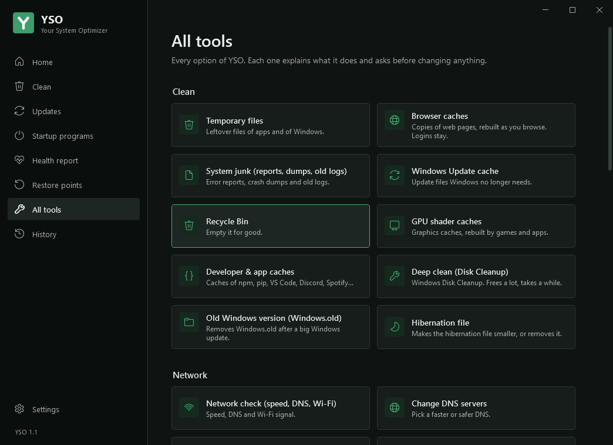
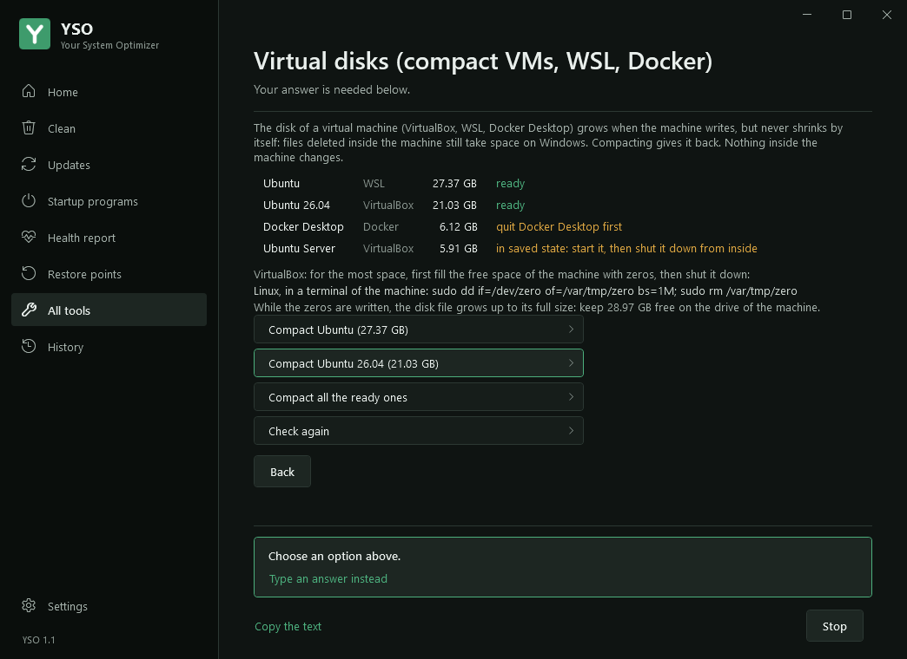
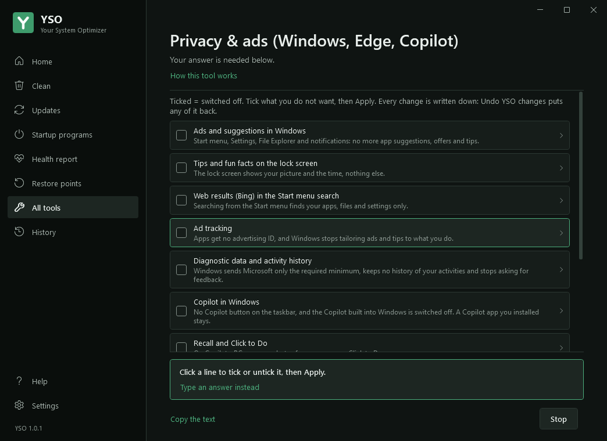
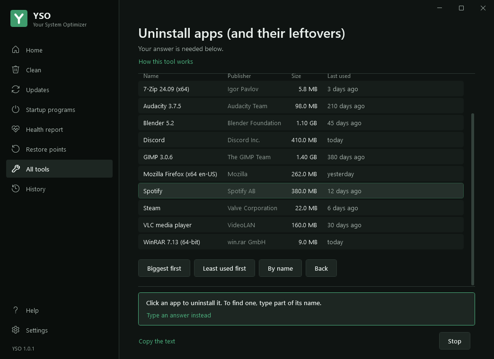
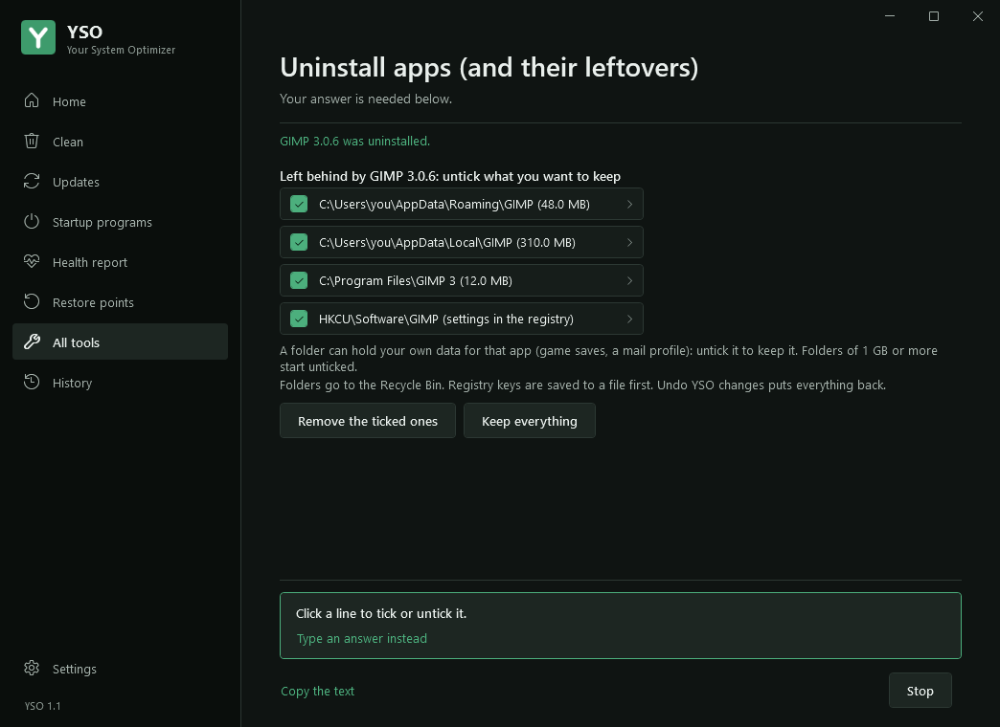
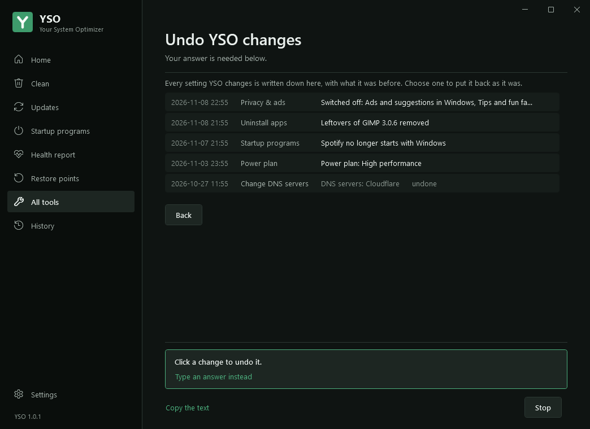
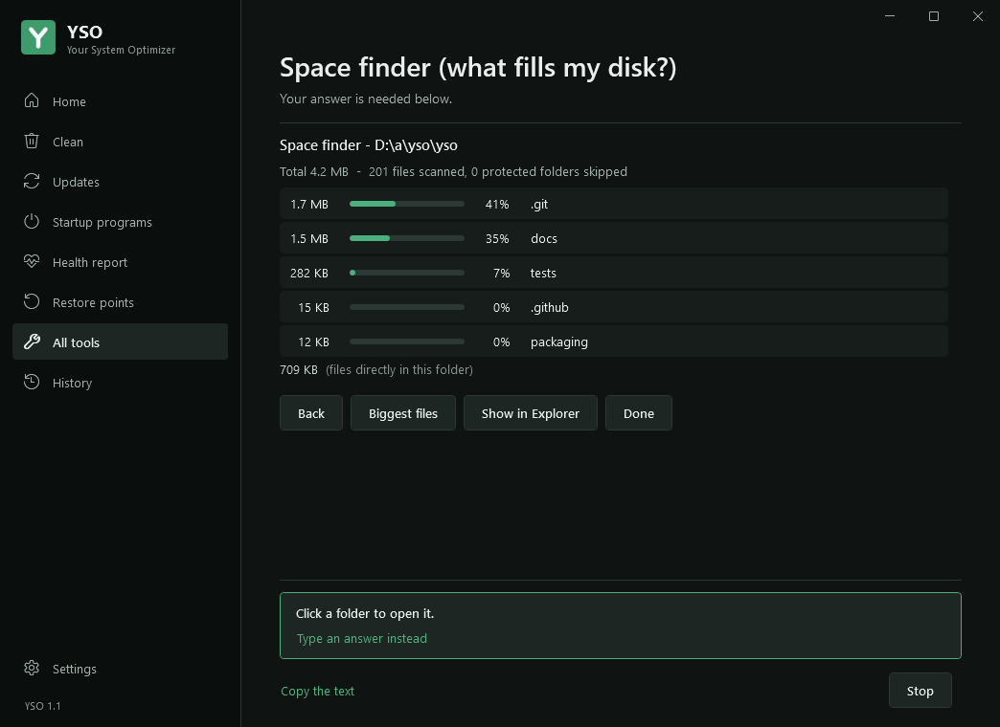

# Changelog

## 1.0.1 - 2026-11-08
The window reads like an app, not like a terminal. Four new tools: virtual disks, privacy and ads, uninstalling apps with their leftovers, and undoing any change YSO made. An optional icon next to the clock warns you before problems, and YSO is ready for the Microsoft Store.

### New tool: Virtual disks (29)
- Finds the disks of **VirtualBox** machines (.vdi, read from VirtualBox's own files), of **WSL** distributions and of **Docker Desktop** (.vhdx), with their size.
- These files grow when the machine writes but never shrink by themselves. Compacting gives back what the machine no longer uses. Nothing inside the machine changes.
- **Checks before anything**: a machine in saved state is refused (start it, then shut it down from inside), a running machine is refused, a machine with snapshots is left alone, and VirtualBox and Docker Desktop must be closed. The reason is written next to each disk, with a "Check again" button.
- **Last warning** before compacting: what will stop, that nothing inside changes, and to copy a disk you cannot lose. The question answers No by default. Each disk is checked again right before it is compacted.
- WSL: unused blocks are freed inside the distribution (fstrim), WSL is stopped (wsl --shutdown), then the disk is compacted read-only with diskpart, which works on every edition of Windows.
- VirtualBox: compacted with VBoxManage. YSO shows the command to run inside the machine first to get the most space back, and how much free space that needs.
- The space freed is shown, kept in the cleanup history and counted like any cleanup. Analyze-only mode lists the disks and changes nothing.

### New tool: Privacy & ads (30)
- Switch off, with tick boxes: **ads and suggestions** in Windows (Start menu, Settings, File Explorer, notifications), **tips on the lock screen**, **web results (Bing)** in the Start menu search, **ad tracking**, **diagnostic data and activity history**, **Copilot**, **Recall and Click to Do** (Copilot+ PCs, Windows 11 24H2 and later), **AI in Edge, Notepad and Paint**, and **ads and suggestions in Edge**.
- A sentence under each one says what changes. "Tick the recommended ones" ticks the four that nobody misses (ads, lock screen tips, Bing, ad tracking).
- Before applying, YSO lists what it will switch off or back on, and says when Windows or Edge will show "managed by your organization" (that is how these settings work). Unticking puts back the Windows default.
- The same settings as Win11Debloat, checked one by one. Nothing about Defender, Windows Update or the Store. Every change is written down: Undo YSO changes puts it back.

### New tool: Uninstall apps (31)
- Every desktop app with its publisher, size and **when it was last used** (from Windows' own Prefetch files). Sort by name, biggest first or least used first, or type part of a name to find it.
- YSO starts **the app's own uninstaller** (Windows Installer apps with `msiexec /x`, never a forced removal), and waits for it, also when it hands over to a copy of itself.
- Then it looks for **what the app left behind**: its folders in AppData, ProgramData and Program Files (also inside the publisher's folder, like `AppData\Mozilla\Firefox`), and its registry keys.
- It never offers the folder of another installed app, a name another app also uses (two versions of Python: nothing is offered), a top folder, a system or profile folder. Folders of 1 GB or more start unticked, and a warning says a folder can hold your own data (game saves, a mail profile).
- What you tick goes to the **Recycle Bin**; registry keys are **saved to a .reg file** first. Undo YSO changes puts both back.
- Runtimes and drivers (Visual C++, .NET, WebView2...) get a warning: other apps need them, and the question answers No by default.

### New tool: Undo YSO changes (32)
- **Every setting YSO changes is written down first**, with what it was before: startup programs switched on or off, power plan, hibernation file, DNS servers, privacy settings, app leftovers removed.
- Undo YSO changes lists them, newest first, in plain words ("Spotify no longer starts with Windows"). Click one to see what it changed, then put it back exactly as it was. A value YSO created goes again, with the empty key it made for it.
- An undone change is marked as such and is not undone twice. The last 300 changes are kept, in `C:\ProgramData\YSO\changes.json`.

### Icon next to the clock (Settings, option 9)
- Off unless you switch it on. It starts with Windows and checks every 6 hours: **disk almost full** (less than 10 GB or 10 % free), **a drive that fails or wears out**, **a worn battery**. It also says what the weekly cleanup freed.
- It tells you only when something needs you, **at most once a week** for each thing, in one notification. Click it to open YSO.
- Right-click: Open YSO, Check my PC now, Remove this icon. Uninstalling YSO removes it too.

### Ready for the Microsoft Store
- The package is built and tested on every change: a small launcher (`YSO.exe`), the manifest, the icons drawn from the YSO mark, `YSO.msix`, then a test install on Windows. See [docs/STORE.md](https://github.com/b-draoui/yso/blob/main/docs/STORE.md) for the steps that need a Partner Center account.
- Installed from the Store, YSO lets the Store update it: no update offer of its own, no install of its own.

### Every tool page redrawn
- Titles are normal titles instead of capitals ("Biggest files", not "BIGGEST FILES").
- Tables are real columns instead of a typewriter font, lined up with each other, numbers on the right, and a thin line instead of a row of dashes.
- Bars instead of `[#####-----]`, and On / Off labels for startup programs.
- A line you can choose (a folder, a file, a program) is a row you click, instead of a number to type.
- Keys to type ("[B] back   [Q] done", "S = Windows Settings") are buttons. "Back", "Cancel" and "Done" are plain buttons under the choices.
- Choices are rows with an arrow instead of numbered badges; settings shown as "[x] Temporary files" have real tick boxes. A choice can have a sentence under it that says what it does.
- Nothing has to be typed any more. "Type an answer instead" is still there for those who want it.
- Menu numbers like "(27)" are taken out of the texts in the window, and the first heading no longer repeats the page title.

### All tools
- Each tool has an icon and one sentence that says what it does ("Flush DNS cache: helps when a site will not load after a change"), instead of a number.
- 32 tools, with a new group: Apps & privacy.

### Space finder and startup programs
- Space finder: pick a drive with one click, or any folder with "Choose a folder...". Click a folder to open it, a file to show it in Explorer.
- Startup programs: click a program to switch it on or off; a button opens the Windows startup settings for apps from the Microsoft Store.

### Cleaning
- **System junk** now also cleans old files in the temp folders of Windows services (`C:\Windows\ServiceProfiles\...\Temp`): crash dumps of several GB each were found there on a real PC. Only files older than the log age setting.
- **Developer & app caches** now include the installers Ollama downloads for its own updates (1.5 GB each), once they are two days old. Ollama downloads one again if it still needs it.

### Also in 1.0.1 (first sent to 1.0 as corrected builds)
- **Updates**: one tick box per update, the recommended ones ticked first, "all" or "none" in one click. Names no longer repeat their version ("Ollama version 0.40.10" is "Ollama"), long names no longer push the versions out of their column, "< 3.15.2" reads "older", and the list says that only apps in the winget catalog are checked.
- **Driver updates** are installed one at a time, so one that fails no longer stops the others, and each failure gives Windows' own reason (before, one update could make all of them fail with 0x80131501).
- **Firmware updates** (BIOS, UEFI) are listed apart and never installed.
- **An app whose new version uses another installer** (winget 0x8A15008E): YSO explains it and offers to reinstall it. Automatic updates never do this.
- **Install all of them**: next to "the recommended ones", a choice that includes new major versions.
- **Battery above 100 %**: shown as 100 % at most; after many charge cycles YSO says the charge gauge needs a reset and how.
- **Windows Update cache** is kept when Windows has downloaded updates it has not installed yet (deleting them only made Windows download them again).
- Readable names for apps found by their cache (Ollama, Outlook, Microsoft Store, Windows Settings...); "yesterday" means the calendar day; copied text no longer shows "Drive C::".
- The window: a message it cannot show is saved in errors.log and skipped, so the question after it still arrives.
- **Update button**: an answer from GitHub kept by another version of YSO (before a reinstall) is no longer used, and a version taken back between the offer and the click is not an error: YSO looks again and offers what GitHub has now, or nothing.

### Tests
- 746 automated checks in 26 groups on Linux, and on every change, Windows Server 2022, Windows Server 2025 and Windows 11 run the self-test, the update check, a real update install, the installation, and draw 19 pages of the window in English and French. Lists that need real machines or past changes (updates, virtual disks, apps to uninstall, the list of changes) are drawn with sample data.
- The Microsoft Store package is built, installed and checked on Windows on every change.
- New checks for the virtual disks (saved state, snapshots, a machine started meanwhile, No to the last warning), for the table columns and colours, for the titles, and for the new tools: every change put back exactly (a value changed twice, a key YSO created, binary values), the privacy settings and their Windows defaults, leftovers that never belong to another app, alerts at most once a week.

**[Every screen of YSO 1.0.1, in English and French](https://github.com/b-draoui/yso/blob/main/docs/SCREENSHOTS.md)**

## 1.0 - 2026-10-25
First public version.

- **A window for everything.** Home shows the health of the PC (disk space and wear, battery, Windows Update, antivirus, startup programs, last cleanup, updates) with the button that helps. **Analyze** shows what can be freed and deletes nothing; **Clean everything** runs the full maintenance after showing what it will do.
- **Clean**: every part on its own line with the space it frees, ticked or not. What cannot be undone (old driver versions, Recycle Bin) starts unticked. Options: restore point first, close the apps that keep files in use, optimize drives, install updates.
- **28 tools** in one place: cleaning (temporary files, browser and app caches, system junk, Windows Update cache, GPU shader caches, deep clean, old driver versions, Windows.old, hibernation file), network (check, DNS, reset), startup programs, boot time, health report, crashes, security check, drivers, disk check, memory test, Windows repair, space finder, app and driver updates (manual, notify or automatic), restore points, weekly auto-clean, history, self-test, problem reports.
- Each tool shows its progress, asks its questions with buttons, and has a **Stop** button. The work runs apart from the window, so the window stays usable while it works.
- **Update button**: when a new version is published on GitHub, YSO offers it. It is downloaded over HTTPS, checked against its SHA-256 file and read by PowerShell before it replaces YSO. The check can be turned off in Settings.
- **Installation in one line** (`install.ps1`): Program Files, Start menu, Desktop, and Settings > Apps > Installed apps with Uninstall, without "Windows protected your PC".
- English and French. Requires Windows 10 version 1607 or later, or Windows 11 (Intel, AMD or ARM).
- Tested on every change: about 600 automated checks on Linux, and the window, the self-test, the update check and the installation on Windows Server 2022, Windows Server 2025 and Windows 11.

Fixes after the first tests on real PCs (same version, corrected build):

- **Driver updates** are installed one at a time, so one that fails no longer stops the others, and each failure gives Windows' own reason. Before, one update could make all of them fail with error 0x80131501.
- **Firmware updates** (BIOS, UEFI, built-in software of a device) are listed apart and never installed, as promised.
- **An app whose new version uses another installer** (winget error 0x8A15008E): YSO explains it and offers to reinstall it (remove the old version, install the new one). Automatic updates never do this.
- **Install all of them**: next to "the recommended ones", a choice to install every update found, new major versions included.
- **Battery above 100 %**: the health shown is never above 100 %. After many charge cycles, YSO says the charge gauge needs a reset and how to do it, instead of showing it as healthy.
- "Yesterday" means the calendar day: an update installed yesterday evening is no longer shown as today.
- Copied text no longer shows "Drive C::"; the update list keeps a space between versions and notes.
- **Windows Update cache**: kept when Windows has downloaded updates it has not installed yet (one PC had 9 GB of them): deleting them only made Windows download them again. YSO names the update and says what to do; Analyze no longer counts it.
- Readable names for apps found by their cache layout (Ollama, Outlook, Microsoft Store, Windows Settings instead of "ollama app.exe", "Olk"...).
- **Updates in the window are ticked, not typed**: each update has its own tick box, the recommended ones are ticked first, and "all" or "none" tick the rest in one click. The console still takes numbers.
- Update names no longer repeat their version ("Ollama version 0.40.10" is now "Ollama"), long names no longer push the versions out of their column, and "< 3.15.2" (winget could not read the installed version) now reads "older".
- The list says that only apps in the winget catalog are checked: the others update from the app itself.
- Installed copies of 1.0 offer these fixes with their Update button.
- Window: a message it cannot show is saved in errors.log and skipped, so the question after it still arrives.
