# Changelog

## 1.0.3 - 2026-11-19
The PC passport: the precise state of each part of the PC, with a score out of 100, tests that check every result, and a detailed PDF for a repair shop or a buyer. And more maintenance: how long Windows still gets security updates, the Secure Boot certificates, the signs of a scam, your browsers, and deeper cleaning.

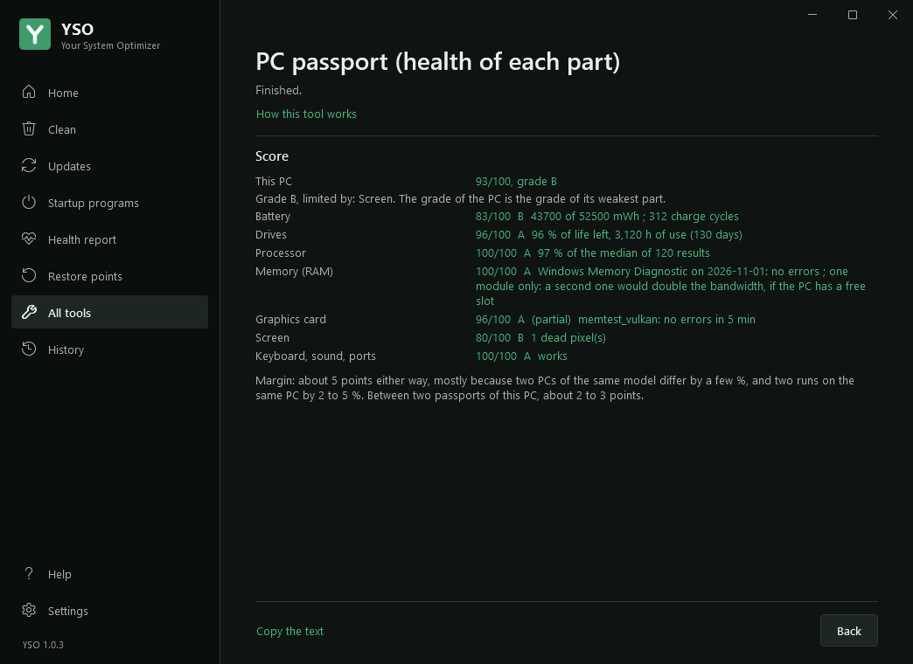

### New tool: PC passport (40)
Each part gets a score out of 100 and a grade, A to D: drives, battery, processor, memory, graphics card, screen, and the rest (keyboard, sound, ports, Wi-Fi). Three levels, and each one says how long it takes:

- **Quick (about 2 minutes)** only reads. What each part reports about itself:
  - **Drives**: the NVMe health log read byte by byte (life used, spare space and its threshold, data read and written, hours, power cycles, unsafe shutdowns, media errors, critical warnings), or the SMART attributes of a SATA drive (life left, reallocated, pending and unreadable sectors).
  - **Battery**: capacity now against capacity when new, charge cycles, and whether its gauge needs a reset.
  - **Processor**: model, cores, microcode. Intel Core 13th and 14th gen desktop chips are checked for the microcode that fixes their instability (0x12F or later).
  - **Memory**: each stick, its rated and actual speed, and the result of Windows Memory Diagnostic.
  - **Graphics card**: temperature, fan and limits from Windows itself (D3DKMT), or from nvidia-smi on NVIDIA cards.
  - **Screen** (maker, model, year), **TPM**, **Secure Boot**, network adapters.
  - **Windows' logs of the last 90 days**: corrected and fatal hardware errors (WHEA 17, 18, 19, 47), graphics driver resets, blue screens, Windows' stability index.
- **Complete (about 20 minutes)** adds the tests:
  - **The processor under load for 10 minutes on every core**, each core pinned and repeating computations whose result is known in advance (SHA-256, floating point, integers). One wrong result means a faulty core, and the processor gets D whatever else it scores. The speed is followed the whole time: how much of it the processor keeps after 10 minutes says how well it is cooled.
  - **A read of each drive**: 512 places over the whole disk, without the cache. Nothing is written. Unreadable places and very slow areas are counted.
  - **Guided tests**: plain colours for dead pixels, stains and light leaks; every key of the keyboard; the touchpad (click, right-click, scroll); a beep in each speaker, in an order YSO picks at random, so "both work" cannot be guessed; the microphone records 3 seconds; the webcam; each USB port; Wi-Fi and Bluetooth; the charger. Each one can be skipped.
- **Complete with the deep test (about 50 minutes)** adds:
  - **The Blender Benchmark**, the official tool of Blender Open Data, on the processor and on the graphics card, three times each. The median of each scene is compared with the median of the public results of the same model with the same Blender version.
  - **memtest_vulkan** checks the video memory for 5 minutes, and the graphics card's temperature and fan are watched during both tests.
  - YSO asks before downloading them (a few hundred MB from download.blender.org and GitHub). The launcher's signature is checked, and memtest_vulkan is checked against the checksum GitHub publishes for it.

**How the score is made.** No consumer processor or graphics card counts its own wear, not even with the maker's tools. So YSO measures what wear causes, with four factors for the processor and the graphics card:

| Factor | Weight | What decides it |
|---|---|---|
| Performance against the same model | 40 | Blender Benchmark against the median of the same model: every point from 95 % of the median, none at 55 % |
| Exact computations | 25 | One wrong result on one core, or video memory errors: grade D |
| Cooling | 20 | The share of its speed the part keeps after 10 minutes of load, and how far its limits drop |
| Stability | 15 | Hardware errors and graphics driver resets in Windows' logs over 90 days |

When the hardware gives a percentage itself (battery health, SSD life left), that percentage is the score. Grades: A from 85, B from 70, C from 50, D below. The battery follows Back Market's threshold for computers (85 %), SSDs their life left (A from 90 %). The grade of the PC is the grade of its weakest part, as refurbishers do; its score is the weighted mean of the parts (drives and battery 20 each, processor and memory 15 each, graphics card, screen and the rest 10 each). The PDF shows every factor, where each value comes from (measured, the maker's estimate, YSO's rule, a test) and every raw value.

**How precise it is.** About 5 points either way for one passport. Two PCs of the same model differ by a few percent, and two runs on the same PC by 2 to 5 %. Between two passports of the same PC, the margin is 2 to 3 points: each passport is kept on the PC, and the next one shows what changed since the first (battery, life left of each drive, data written, the processor's speed with the same Blender). A counter that went back is flagged: the part was changed or its counter reset.

**The PDF.** On your Desktop, in English or French, with the JSON file of every measure and its fingerprint. "For a professional" has the full serial numbers; "for a listing" keeps only their last 4 characters. Neither has your user name or the PC name. The limits are written in it: the exact processor temperature needs a kernel driver, which YSO does not install; a test that passes does not prove that a rare fault never happens; the owner made the report, nobody certified it.

The reference results come from the public Blender Open Data (CC0), turned into one median per model, version and scene by a weekly workflow of this repository (`data/blender-medians.json`). Without a reference for a model, the score is measured but not compared.

### Security check (21)
- **Windows support**: until when this version of Windows gets security updates, from Microsoft's lifecycle dates (Home and Pro, Enterprise and Education, LTSC). Windows 11 24H2 Home and Pro got their last update in October 2026: YSO says so and points to the newer version. Windows 10 22H2 is covered until October 12, 2027 only if the PC is enrolled in Extended Security Updates. The home page warns when the end is less than 90 days away or past.
- **Secure Boot certificates**: Microsoft's 2011 certificates expired in 2026. YSO says whether the 2023 ones are in the firmware, whether Windows is installing them, or whether a BIOS update is needed.
- **Signs of a scam or hijack**, each one explained, since each can also be normal:
  - **Remote access apps** (AnyDesk, TeamViewer, RustDesk, ScreenConnect and about 20 others), installed, running or starting with Windows.
  - **Commands pasted in Win+R** that download and run something: what fake "I am not a robot" pages ask people to do (ClickFix).
  - **The hosts file**: a site sent to another address, or security and update sites blocked. A plain ad blocker list is told apart.
  - **A proxy** set for your account.

### Health report (19)
- How long this Windows gets security updates, and **Windows' stability index** (Reliability Monitor).
- **What woke the PC** in the last 7 days, and how to stop a mouse or network card from doing it.
- **Memory**: running slower than it is made for, or one stick alone (a second identical one doubles the bandwidth).
- On laptops with modern standby, the **sleep report**: what used the battery while the PC was asleep.

### Browsers (39, formerly Browser extensions)
- The **default search engine** of each Chrome, Edge, Brave, Vivaldi and Opera profile, flagged when it is not a known one.
- The **sites allowed to send notifications**, where the "you have a virus" pop-ups near the clock come from, and where to stop them.
- The **policies a program set**: extensions installed by force, a search engine, home page or proxy you cannot change ("Managed by your organization").

### Privacy & ads (30)
- **Unwanted apps that come with downloads**: Microsoft Defender and Edge block the toolbars, coupon add-ons, coin miners and ad injectors bundled with free programs. Recommended. Undo puts it back.

### Deeper cleaning
- **More space from Windows (33)**, five new lines:
  - **Old copies of Windows updates (WinSxS)**: measured first (about a minute), then cleaned. Locking in the installed updates (ResetBase) is a separate question, No by default.
  - **Old driver versions**, each one listed with the newest version that replaced it.
  - **Parts of Windows you do not use**, with tick boxes: Math Input Panel, Steps Recorder, WordPad, XPS Viewer, and the handwriting, text recognition and speech of languages you do not use. Your languages, English (US) and spelling are always kept. Undo downloads a part again from Windows Update.
  - **Accounts nobody used for 6 months**: never the account in use, one that is signed in, Windows' own accounts or an administrator. YSO shows the size and last use of each one and asks one by one, No by default.
  - **The Windows Installer cache**: its size, shown only, with why its files must not be deleted by hand.
- **Files you might not need (34)**, three new lines:
  - **Build folders of code projects**: node_modules, target, .next and .nuxt, bin and obj, .gradle, only next to the file that makes them a project (package.json, Cargo.toml, a .csproj...). Those of projects not changed for 90 days are ticked; the project's own tool makes them again. AppData and hidden folders are never read.
  - **WhatsApp photos and videos** and the **Telegram cache** of the PC apps, shown only, with how to empty them the app's way.

### Tests
- 948 automated checks in 29 groups on Linux. A new group for the passport and the new maintenance items: the NVMe and SMART logs read from made-up bytes, the grades and their thresholds, a wrong computation that sends the processor to D, a desktop without battery, the PDF with and without full serial numbers, what changed since the first passport, Blender's JSON against a median, the Windows lifecycle dates, ClickFix commands, the hosts file, the DISM analysis, unused languages, and code build folders found and ticked by age.
- The window draws 27 pages in English and French on Windows, the passport with a sample PC.

## 1.0.2 - 2026-11-17
YSO digs deeper and does more. Seven new tools (39 in all), cleaning that reaches developer, creative and AI caches, and new options in the health report, the updates and the uninstaller.

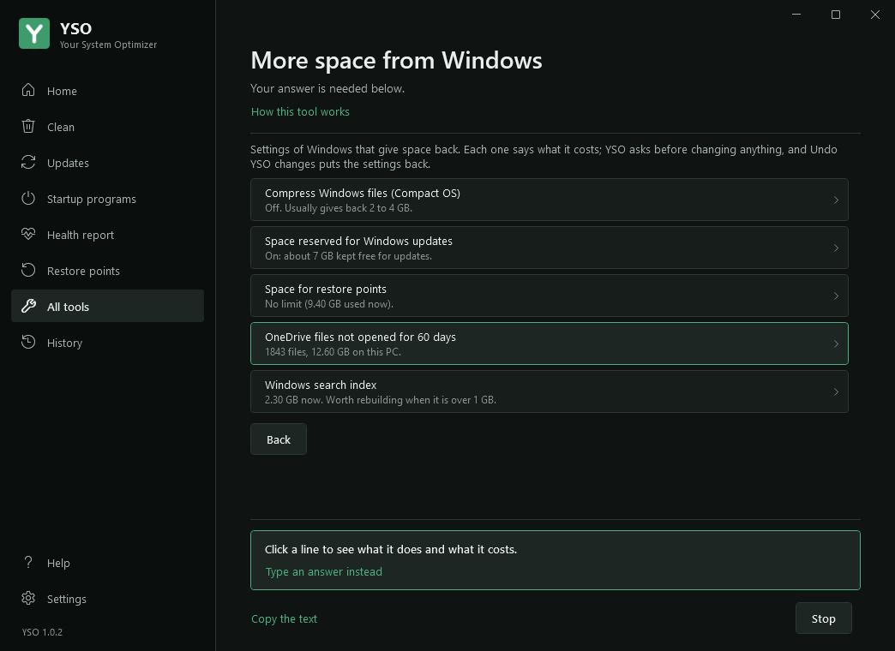

### New tool: More space from Windows (33)
- Settings of Windows itself that give space back, each with what it costs before YSO asks:
  - **Compact OS**: Windows compresses its own files, usually 2 to 4 GB.
  - **Reserved storage**: the 7 GB or so Windows keeps for updates.
  - **Restore points**: limited to 5 % of the drive (at least 5 GB) when they have no limit.
  - **OneDrive files** not opened for 60 days become online only. Nothing is deleted, and files set to "Always keep on this device" are left alone.
  - **Search index**: rebuilt when it is over 1 GB.
- Compact OS, reserved storage and the restore point limit are written down: Undo YSO changes puts them back.

### New tool: Files you might not need (34)
- Old installers and disk images in Downloads, **iPhone and iPad backups** (with the device name), and **files that are there twice**. Same size, then the first 64 KB, then the whole file: only real copies are shown.
- YSO deletes nothing here. A click shows the file in File Explorer, and you decide there. OneDrive files that are online only are never read.

### New tool: My PC over time (35)
- Once a day, when YSO opens, it writes down the startup time, the free space and the number of programs at startup.
- The page compares the first day with today ("startup 42 s (62 s before), 10 GB more free space, 7 fewer programs at startup"), then shows one line a week. After a week, the home page shows it too.

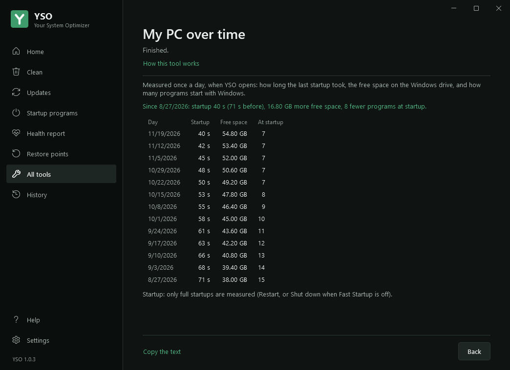

### New tool: Disk speed & temperature (36)
- Each drive with its kind (NVMe, SSD, hard drive, USB), temperature, wear and hours of use.
- A read and write speed test with Windows' own tool (winsat), with what is normal for that kind of drive. A 900 MB/s NVMe is "a bit slow"; a 150 MB/s hard drive is fast.

### New tool: Right-click menu (37)
- On Windows 11, the **classic right-click menu** (everything at once, no "Show more options").
- The entries other programs add to the menu, each switched on or off with Windows' own list of blocked entries. The program keeps working. YSO offers to restart File Explorer.

### New tool: Performance mode (38)
- For older PCs: no animations, transparency, shadows or fading menus, and faster menus. Text stays smooth. The same as Windows' "Adjust for best performance", for your account, and Undo puts it back.

### New tool: Browser extensions (39)
- Every extension of Chrome, Edge, Brave, Vivaldi, Opera and Firefox, on or off, and what it may do: read and change every site, see your browsing, or little. Extensions that do not come from the store are flagged. Only shown: removing one is done in the browser.

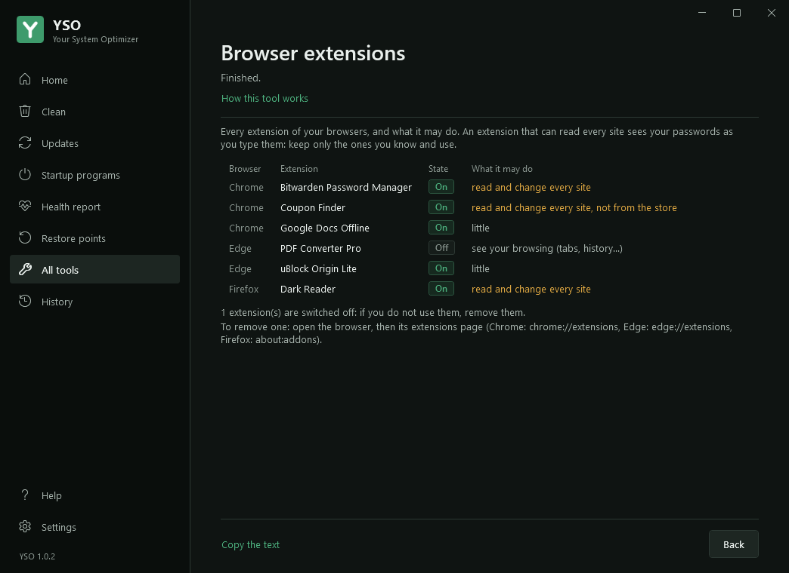

### Deeper cleaning
- **Developer & app caches (7)**: Maven, Rust (cargo), Go, uv, pnpm, conda archives, JetBrains IDEs, Adobe media cache, Unity and Unreal. Downloaded libraries and media caches go only when they were not changed for 30 days (90 for Gradle and Maven libraries). Projects, environments and settings are never touched.
- **Steam**: downloads and updates stopped for a week. Steam downloads them again when you resume them.
- **AI models downloaded with Hugging Face** are shown with their size, and deleted only if you say yes (No by default).
- **System junk (3)**: the installer files NVIDIA and AMD drivers leave on the disk.
- **Old Windows version (9)**: the folders Windows upgrades leave behind ($WINDOWS.~BT, $WINDOWS.~WS, $GetCurrent). They are kept while you can still go back to the previous version, and while an upgrade runs. C:\ESD stays.
- **Virtual disks (29)**: **D** cleans Docker first (stopped containers, unused images and build cache; your volumes stay), so compacting gives more back. Each disk shows the most it can grow to.

### In existing tools
- **Health report (19)**: a one-page **PDF** on your Desktop, to send to someone who helps you. No user name, PC name or file name in it. Without Edge, it is saved as a web page to print.
- **Updates (28 > 7)**: the hours when Windows must not restart, and a **pause of Windows updates** for 1 to 5 weeks, like Settings does it. Undo puts them back.
- **Uninstall apps (31 > W)**: the **apps Windows put on the PC** (Candy Crush, TikTok, News, Clipchamp...). "Tick the usual ones" never touches the Store, Photos, Calculator, Notepad, Paint, Terminal, Xbox or drivers' apps. Undo installs an app again, or opens its page in the Microsoft Store.
- **Undo YSO changes (32)** knows every new setting.

### Tests
- 867 automated checks in 28 groups on Linux. A new group for tools 33 to 39: every setting put back exactly, nothing deleted by the tools that only show, copies found only when the content is the same, verdicts on speed and temperature, extensions read from the browsers' own files, and a PDF report without names.
- The window draws 26 pages in English and French on Windows, the new ones with sample data.

**[Every screen of YSO 1.0.2, in English and French](https://github.com/b-draoui/yso/blob/main/docs/SCREENSHOTS.md)**

## 1.0.1 - 2026-11-08
The window reads like an app, not like a terminal. Four new tools: virtual disks, privacy and ads, uninstalling apps with their leftovers, and undoing any change YSO made. An optional icon next to the clock warns you before problems, and YSO is ready for the Microsoft Store.

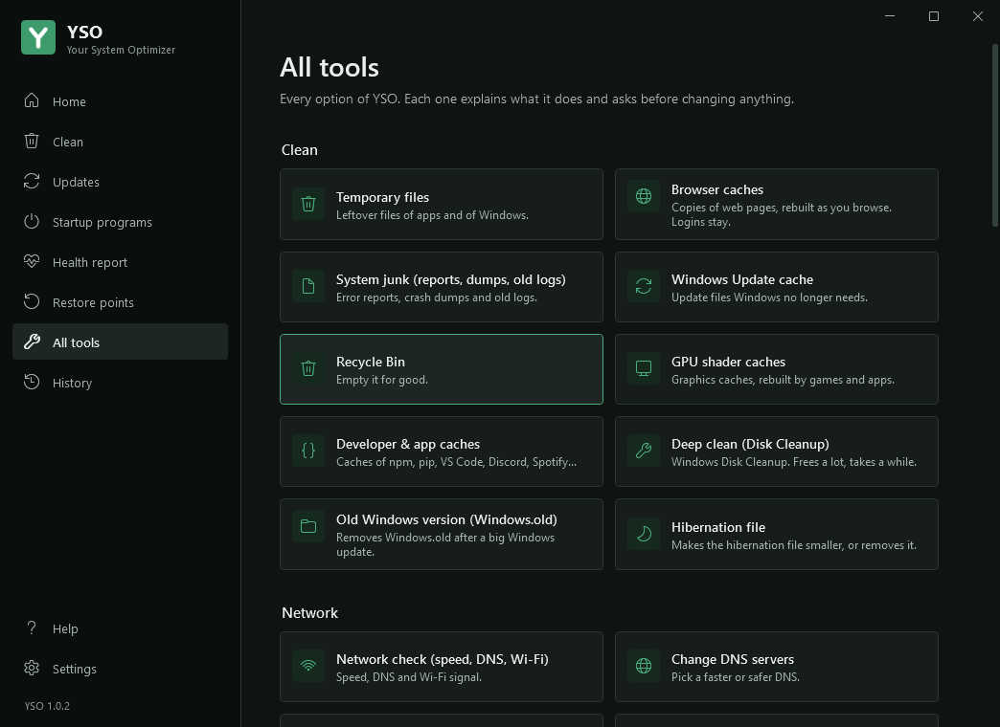

### New tool: Virtual disks (29)
- Finds the disks of **VirtualBox** machines (.vdi, read from VirtualBox's own files), of **WSL** distributions and of **Docker Desktop** (.vhdx), with their size.
- These files grow when the machine writes but never shrink by themselves. Compacting gives back what the machine no longer uses. Nothing inside the machine changes.
- **Checks before anything**: a machine in saved state is refused (start it, then shut it down from inside), a running machine is refused, a machine with snapshots is left alone, and VirtualBox and Docker Desktop must be closed. The reason is written next to each disk, with a "Check again" button.
- **Last warning** before compacting: what will stop, that nothing inside changes, and to copy a disk you cannot lose. The question answers No by default. Each disk is checked again right before it is compacted.
- WSL: unused blocks are freed inside the distribution (fstrim), WSL is stopped (wsl --shutdown), then the disk is compacted read-only with diskpart, which works on every edition of Windows.
- VirtualBox: compacted with VBoxManage. YSO shows the command to run inside the machine first to get the most space back, and how much free space that needs.
- The space freed is shown, kept in the cleanup history and counted like any cleanup. Analyze-only mode lists the disks and changes nothing.

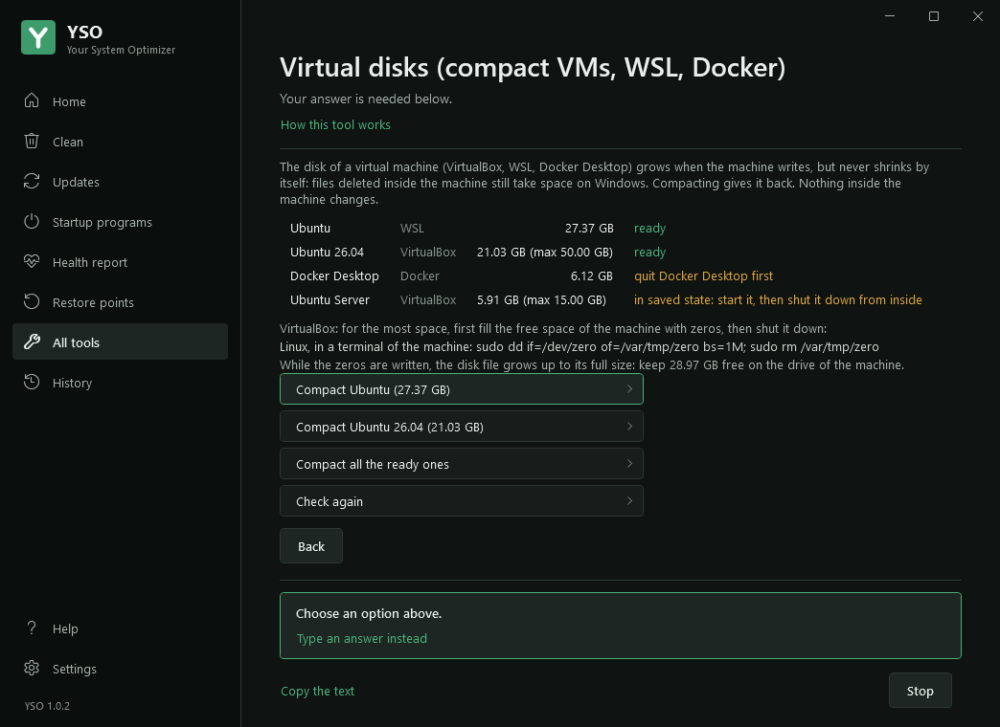

### New tool: Privacy & ads (30)
- Switch off, with tick boxes: **ads and suggestions** in Windows (Start menu, Settings, File Explorer, notifications), **tips on the lock screen**, **web results (Bing)** in the Start menu search, **ad tracking**, **diagnostic data and activity history**, **Copilot**, **Recall and Click to Do** (Copilot+ PCs, Windows 11 24H2 and later), **AI in Edge, Notepad and Paint**, and **ads and suggestions in Edge**.
- A sentence under each one says what changes. "Tick the recommended ones" ticks the four that nobody misses (ads, lock screen tips, Bing, ad tracking).
- Before applying, YSO lists what it will switch off or back on, and says when Windows or Edge will show "managed by your organization" (that is how these settings work). Unticking puts back the Windows default.
- The same settings as Win11Debloat, checked one by one. Nothing about Defender, Windows Update or the Store. Every change is written down: Undo YSO changes puts it back.

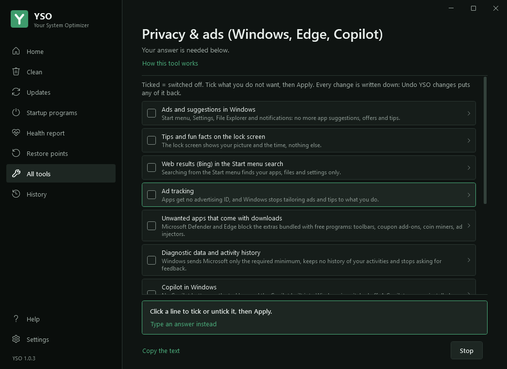

### New tool: Uninstall apps (31)
- Every desktop app with its publisher, size and **when it was last used** (from Windows' own Prefetch files). Sort by name, biggest first or least used first, or type part of a name to find it.
- YSO starts **the app's own uninstaller** (Windows Installer apps with `msiexec /x`, never a forced removal), and waits for it, also when it hands over to a copy of itself.
- Then it looks for **what the app left behind**: its folders in AppData, ProgramData and Program Files (also inside the publisher's folder, like `AppData\Mozilla\Firefox`), and its registry keys.
- It never offers the folder of another installed app, a name another app also uses (two versions of Python: nothing is offered), a top folder, a system or profile folder. Folders of 1 GB or more start unticked, and a warning says a folder can hold your own data (game saves, a mail profile).
- What you tick goes to the **Recycle Bin**; registry keys are **saved to a .reg file** first. Undo YSO changes puts both back.
- Runtimes and drivers (Visual C++, .NET, WebView2...) get a warning: other apps need them, and the question answers No by default.

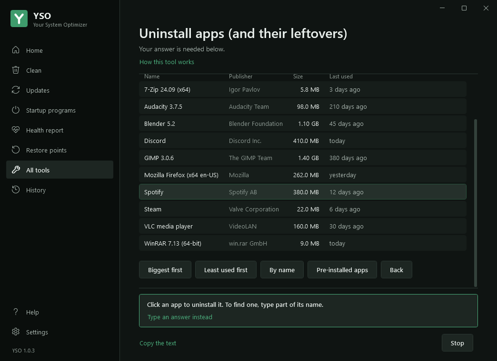

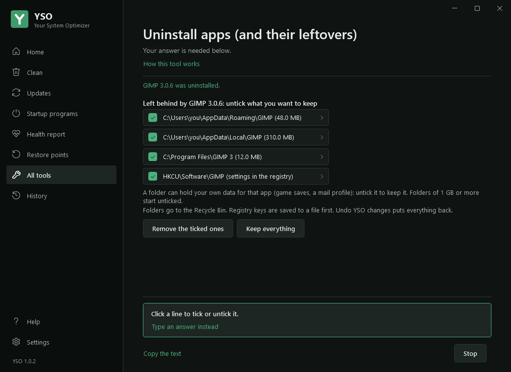

### New tool: Undo YSO changes (32)
- **Every setting YSO changes is written down first**, with what it was before: startup programs switched on or off, power plan, hibernation file, DNS servers, privacy settings, app leftovers removed.
- Undo YSO changes lists them, newest first, in plain words ("Spotify no longer starts with Windows"). Click one to see what it changed, then put it back exactly as it was. A value YSO created goes again, with the empty key it made for it.
- An undone change is marked as such and is not undone twice. The last 300 changes are kept, in `C:\ProgramData\YSO\changes.json`.

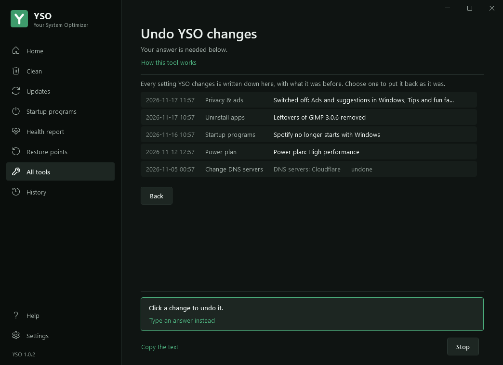

### Help: every tool explained
- A new **Help** page in the window: each tool has a card that opens to say what it does, what it changes, how to undo it, and step by step for the tools that need it (virtual disks, privacy, uninstalling, updates). A search box finds a tool by any word, and "Open this tool" starts it.
- Each tool page has a **How this tool works** link that opens its card.
- In the console menu: **G**, the same guide.
- On GitHub: [docs/GUIDE.md](https://github.com/b-draoui/yso/blob/main/docs/GUIDE.md) and [docs/GUIDE.fr.md](https://github.com/b-draoui/yso/blob/main/docs/GUIDE.fr.md), made from the same texts, so they never differ from the app.

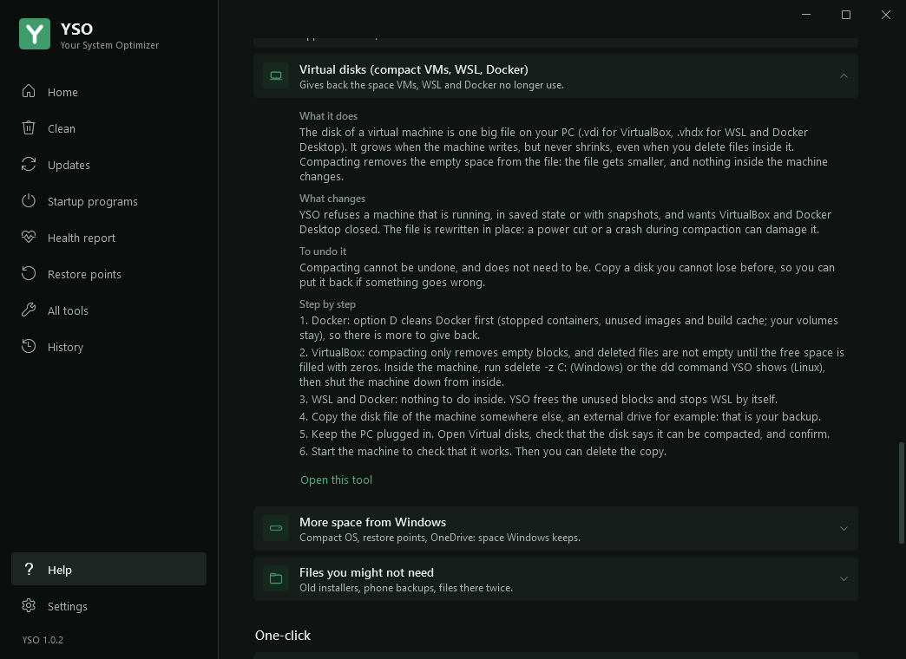

### Icon next to the clock (Settings, option 9)
- Off unless you switch it on. It starts with Windows and checks every 6 hours: **disk almost full** (less than 10 GB or 10 % free), **a drive that fails or wears out**, **a worn battery**. It also says what the weekly cleanup freed.
- It tells you only when something needs you, **at most once a week** for each thing, in one notification. Click it to open YSO.
- Right-click: Open YSO, Check my PC now, Remove this icon. Uninstalling YSO removes it too.

### Ready for the Microsoft Store
- The package is built and tested on every change: a small launcher (`YSO.exe`), the manifest, the icons drawn from the YSO mark, `YSO.msix`, then a test install on Windows. See [docs/STORE.md](https://github.com/b-draoui/yso/blob/main/docs/STORE.md) for the steps that need a Partner Center account.
- Installed from the Store, YSO lets the Store update it: no update offer of its own, no install of its own.

### Every tool page redrawn
- Titles are normal titles instead of capitals ("Biggest files", not "BIGGEST FILES").
- Tables are real columns instead of a typewriter font, lined up with each other, numbers on the right, and a thin line instead of a row of dashes.
- Bars instead of `[#####-----]`, and On / Off labels for startup programs.
- A line you can choose (a folder, a file, a program) is a row you click, instead of a number to type.
- Keys to type ("[B] back   [Q] done", "S = Windows Settings") are buttons. "Back", "Cancel" and "Done" are plain buttons under the choices.
- Choices are rows with an arrow instead of numbered badges; settings shown as "[x] Temporary files" have real tick boxes. A choice can have a sentence under it that says what it does.
- Nothing has to be typed any more. "Type an answer instead" is still there for those who want it.
- Menu numbers like "(27)" are taken out of the texts in the window, and the first heading no longer repeats the page title.

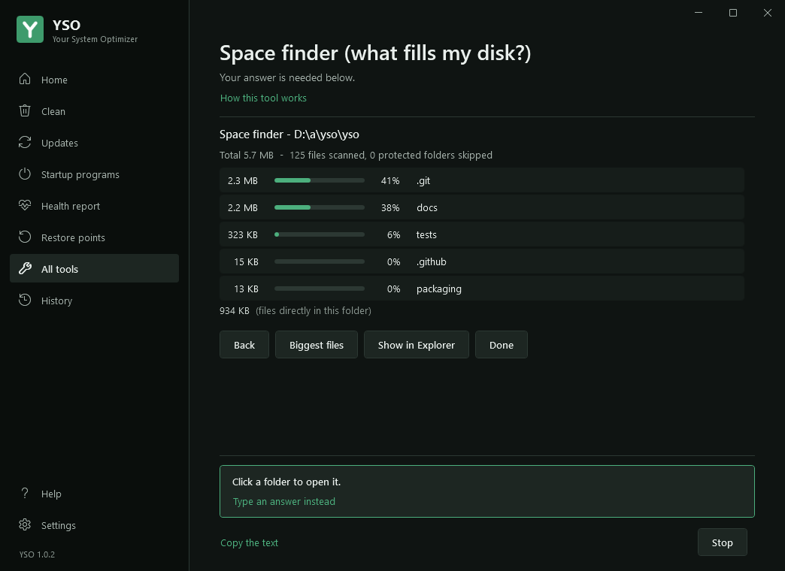

### All tools
- Each tool has an icon and one sentence that says what it does ("Flush DNS cache: helps when a site will not load after a change"), instead of a number.
- 32 tools, with a new group: Apps & privacy.

### Space finder and startup programs
- Space finder: pick a drive with one click, or any folder with "Choose a folder...". Click a folder to open it, a file to show it in Explorer.
- Startup programs: click a program to switch it on or off; a button opens the Windows startup settings for apps from the Microsoft Store.

### Cleaning
- **System junk** now also cleans old files in the temp folders of Windows services (`C:\Windows\ServiceProfiles\...\Temp`): crash dumps of several GB each were found there on a real PC. Only files older than the log age setting.
- **Developer & app caches** now include the installers Ollama downloads for its own updates (1.5 GB each), once they are two days old. Ollama downloads one again if it still needs it.

### Also in 1.0.1 (first sent to 1.0 as corrected builds)
- **Updates**: one tick box per update, the recommended ones ticked first, "all" or "none" in one click. Names no longer repeat their version ("Ollama version 0.40.10" is "Ollama"), long names no longer push the versions out of their column, "< 3.15.2" reads "older", and the list says that only apps in the winget catalog are checked.
- **Driver updates** are installed one at a time, so one that fails no longer stops the others, and each failure gives Windows' own reason (before, one update could make all of them fail with 0x80131501).
- **Firmware updates** (BIOS, UEFI) are listed apart and never installed.
- **An app whose new version uses another installer** (winget 0x8A15008E): YSO explains it and offers to reinstall it. Automatic updates never do this.
- **Install all of them**: next to "the recommended ones", a choice that includes new major versions.
- **Battery above 100 %**: shown as 100 % at most; after many charge cycles YSO says the charge gauge needs a reset and how.
- **Windows Update cache** is kept when Windows has downloaded updates it has not installed yet (deleting them only made Windows download them again).
- Readable names for apps found by their cache (Ollama, Outlook, Microsoft Store, Windows Settings...); "yesterday" means the calendar day; copied text no longer shows "Drive C::".
- The window: a message it cannot show is saved in errors.log and skipped, so the question after it still arrives.
- **Update button**: an answer from GitHub kept by another version of YSO (before a reinstall) is no longer used, and a version taken back between the offer and the click is not an error: YSO looks again and offers what GitHub has now, or nothing.

### Tests
- 746 automated checks in 26 groups on Linux, and on every change, Windows Server 2022, Windows Server 2025 and Windows 11 run the self-test, the update check, a real update install, the installation, and draw 19 pages of the window in English and French. Lists that need real machines or past changes (updates, virtual disks, apps to uninstall, the list of changes) are drawn with sample data.
- The Microsoft Store package is built, installed and checked on Windows on every change.
- New checks for the virtual disks (saved state, snapshots, a machine started meanwhile, No to the last warning), for the table columns and colours, for the titles, and for the new tools: every change put back exactly (a value changed twice, a key YSO created, binary values), the privacy settings and their Windows defaults, leftovers that never belong to another app, alerts at most once a week.

**[Every screen of YSO 1.0.1, in English and French](https://github.com/b-draoui/yso/blob/main/docs/SCREENSHOTS.md)**

## 1.0 - 2026-10-25
First public version.

- **A window for everything.** Home shows the health of the PC (disk space and wear, battery, Windows Update, antivirus, startup programs, last cleanup, updates) with the button that helps. **Analyze** shows what can be freed and deletes nothing; **Clean everything** runs the full maintenance after showing what it will do.
- **Clean**: every part on its own line with the space it frees, ticked or not. What cannot be undone (old driver versions, Recycle Bin) starts unticked. Options: restore point first, close the apps that keep files in use, optimize drives, install updates.
- **28 tools** in one place: cleaning (temporary files, browser and app caches, system junk, Windows Update cache, GPU shader caches, deep clean, old driver versions, Windows.old, hibernation file), network (check, DNS, reset), startup programs, boot time, health report, crashes, security check, drivers, disk check, memory test, Windows repair, space finder, app and driver updates (manual, notify or automatic), restore points, weekly auto-clean, history, self-test, problem reports.
- Each tool shows its progress, asks its questions with buttons, and has a **Stop** button. The work runs apart from the window, so the window stays usable while it works.
- **Update button**: when a new version is published on GitHub, YSO offers it. It is downloaded over HTTPS, checked against its SHA-256 file and read by PowerShell before it replaces YSO. The check can be turned off in Settings.
- **Installation in one line** (`install.ps1`): Program Files, Start menu, Desktop, and Settings > Apps > Installed apps with Uninstall, without "Windows protected your PC".
- English and French. Requires Windows 10 version 1607 or later, or Windows 11 (Intel, AMD or ARM).
- Tested on every change: about 600 automated checks on Linux, and the window, the self-test, the update check and the installation on Windows Server 2022, Windows Server 2025 and Windows 11.

Fixes after the first tests on real PCs (same version, corrected build):

- **Driver updates** are installed one at a time, so one that fails no longer stops the others, and each failure gives Windows' own reason. Before, one update could make all of them fail with error 0x80131501.
- **Firmware updates** (BIOS, UEFI, built-in software of a device) are listed apart and never installed, as promised.
- **An app whose new version uses another installer** (winget error 0x8A15008E): YSO explains it and offers to reinstall it (remove the old version, install the new one). Automatic updates never do this.
- **Install all of them**: next to "the recommended ones", a choice to install every update found, new major versions included.
- **Battery above 100 %**: the health shown is never above 100 %. After many charge cycles, YSO says the charge gauge needs a reset and how to do it, instead of showing it as healthy.
- "Yesterday" means the calendar day: an update installed yesterday evening is no longer shown as today.
- Copied text no longer shows "Drive C::"; the update list keeps a space between versions and notes.
- **Windows Update cache**: kept when Windows has downloaded updates it has not installed yet (one PC had 9 GB of them): deleting them only made Windows download them again. YSO names the update and says what to do; Analyze no longer counts it.
- Readable names for apps found by their cache layout (Ollama, Outlook, Microsoft Store, Windows Settings instead of "ollama app.exe", "Olk"...).
- **Updates in the window are ticked, not typed**: each update has its own tick box, the recommended ones are ticked first, and "all" or "none" tick the rest in one click. The console still takes numbers.
- Update names no longer repeat their version ("Ollama version 0.40.10" is now "Ollama"), long names no longer push the versions out of their column, and "< 3.15.2" (winget could not read the installed version) now reads "older".
- The list says that only apps in the winget catalog are checked: the others update from the app itself.
- Installed copies of 1.0 offer these fixes with their Update button.
- Window: a message it cannot show is saved in errors.log and skipped, so the question after it still arrives.
