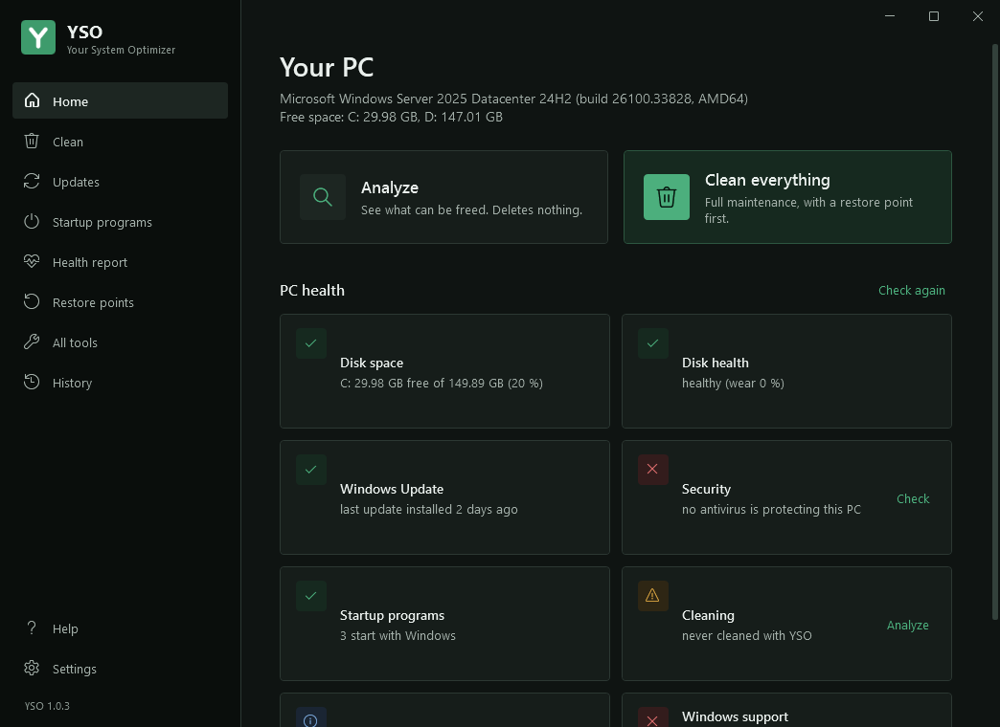
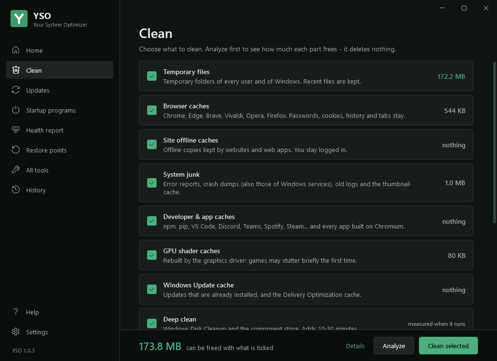
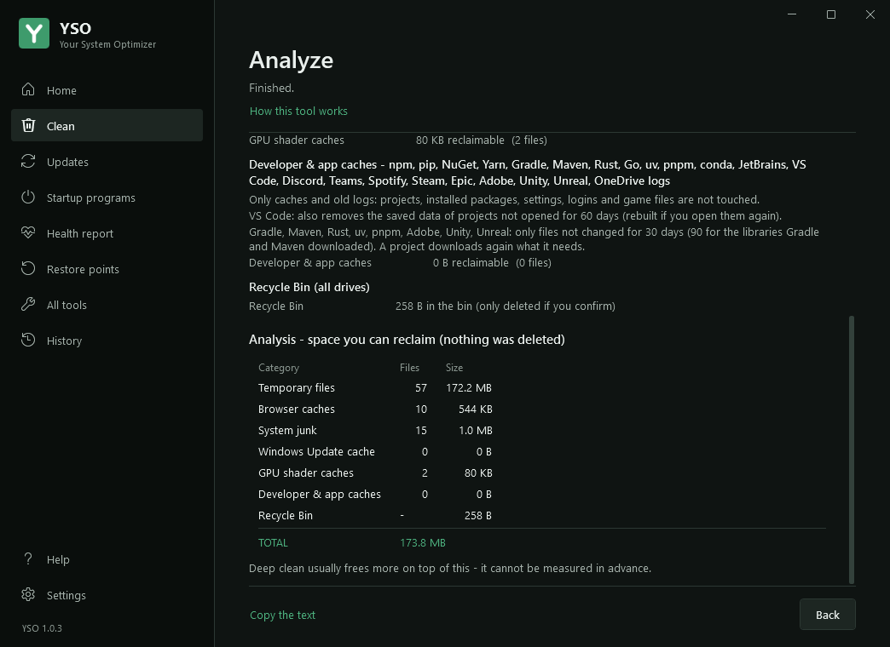
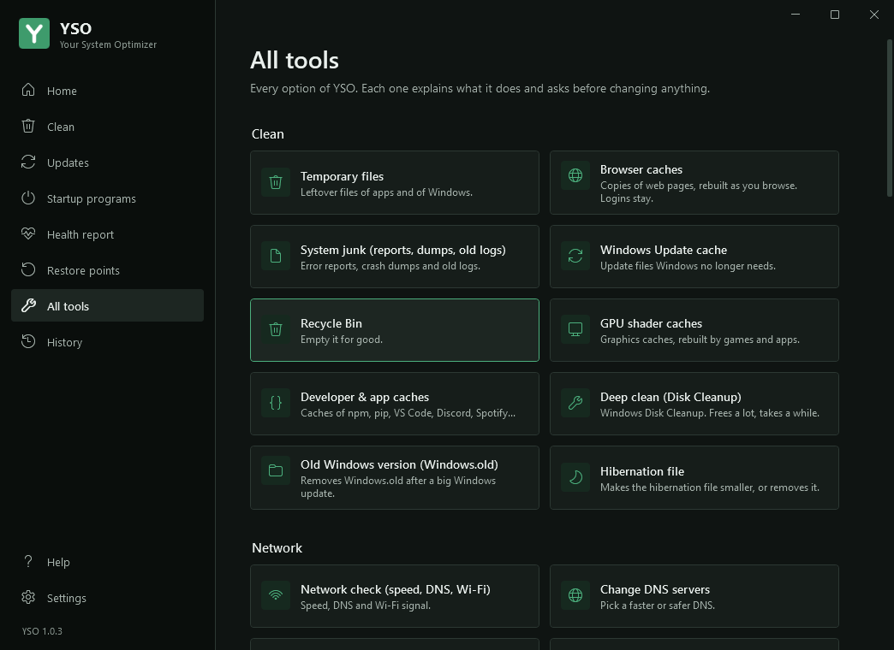

# YSO - Your System Optimizer

[](https://github.com/b-draoui/yso/actions/workflows/tests.yml)

A free, open-source Windows cleaner, health check and maintenance tool. One PowerShell script with its own window: no ads, no account, no telemetry.

**[Version française plus bas](#français)**



## Install

Right-click the Start button > **Terminal** (or Windows PowerShell), paste this line and press Enter:

```powershell
irm https://raw.githubusercontent.com/b-draoui/yso/main/install.ps1 | iex
```

From the Command Prompt (cmd), use this line instead:

```bat
powershell -NoProfile -ExecutionPolicy Bypass -Command "irm https://raw.githubusercontent.com/b-draoui/yso/main/install.ps1 | iex"
```

Windows asks for administrator rights, then YSO opens. It is installed in `C:\Program Files\YSO`, with a shortcut in the Start menu and on the Desktop. [install.ps1](install.ps1) is short: it downloads the latest release from GitHub, checks it against its SHA-256 file, and installs it. Because PowerShell downloads it, Windows does not show "Windows protected your PC".

To uninstall: Settings > Apps > Installed apps > YSO > Uninstall. YSO asks whether to keep its history and settings.

## What it does

| | |
|---|---|
| **Home** | The health of the PC in green, orange or red: disk space and wear, battery, Windows Update, antivirus, startup programs, last cleanup, app updates. Each card has the button that helps. |
| **Analyze** | Measures what can be freed, part by part. Deletes nothing. |
| **Clean** | Temporary files, browser caches (every profile of Chrome, Edge, Brave, Vivaldi, Opera, Firefox), offline copies kept by websites, system junk, developer and app caches (npm, pip, Gradle, Maven, Rust, Go, conda, JetBrains, Adobe, Unity, Unreal, any app built on Chromium...), GPU shader caches, Windows Update cache, Windows Disk Cleanup and the component store. Old driver versions and the Recycle Bin only if you tick them. |
| **Updates** | App updates with winget and driver updates with Windows Update, in one list where you tick what to install: manual, "notify me", or automatic on a schedule. Only apps in the winget catalog are checked. Also the hours when Windows must not restart, and a pause of 1 to 5 weeks. |
| **Startup programs** | Switched on and off the same way as Task Manager, with publisher and boot impact. |
| **PC passport** | The precise state of each part: drives, battery, processor, memory, graphics card, screen and devices, each with a score out of 100 and a grade (A to D). It reads what the parts report about themselves (NVMe and SMART logs, battery capacity, hardware errors of the last 90 days), then can test them: the processor under load with every computation checked core by core, a read of each drive, guided tests of the screen, keyboard, sound, microphone, webcam and ports, and a deep test that compares the PC with the same model on Blender Open Data. A detailed PDF for a professional or a buyer. |
| **Health report** | Disk wear, battery capacity, Windows Update status and how long this Windows gets security updates, crashes, stability index, what woke the PC, security, drivers. Saved as a one-page PDF to send to someone who helps you, without names. |
| **Restore points** | See them, create one, keep only the newest. |
| **Virtual disks** | Gives back the space that VirtualBox machines, WSL and Docker Desktop no longer use (their disk files never shrink by themselves). Refuses a machine that is running, saved or has snapshots, and asks before anything. |
| **Security check** | Antivirus, firewall, encryption, how long this version of Windows gets security updates, the Secure Boot certificates, and the signs of a scam or hijack: remote access apps, commands pasted in Win+R that download something, a hosts file or a proxy someone set. |
| **Privacy & ads** | Tick boxes to switch off ads and suggestions in Windows and Edge, lock screen tips, Bing in the Start menu search, ad tracking, unwanted apps that come with downloads, diagnostic data, Copilot, Recall, and the AI buttons of Edge, Notepad and Paint. |
| **Uninstall apps** | Each app with its size and when it was last used. Runs the app's own uninstaller, then shows what it left behind (folders, registry keys) and removes what you tick, to the Recycle Bin. Never another app's folders. Also removes the apps Windows put on the PC (Candy Crush, TikTok, News...). |
| **More space from Windows** | Compact OS, the space Windows reserves for updates, the space for restore points, OneDrive files not opened for 60 days, a search index that grew too big, old copies of Windows updates (WinSxS), old driver versions, optional parts of Windows you do not use, accounts nobody used for 6 months. Each one says what it costs, and asks. |
| **Files you might not need** | Old installers in Downloads, iPhone and iPad backups, files that are there twice, WhatsApp and Telegram media: only shown, you decide in File Explorer. Build folders of code projects (node_modules, target, bin and obj...), deleted when you tick them. |
| **My PC over time** | Startup time, free space and programs at startup, measured once a day, compared with the first day. |
| **Disk speed & temperature** | Type, temperature, wear and hours of each drive, and a read and write speed test with what is normal for that kind of drive. |
| **Right-click menu** | The classic menu on Windows 11, and the entries other programs add to it, each switched on or off. |
| **Performance mode** | For older PCs: fewer animations and effects, so Windows answers faster. |
| **Browsers** | Every extension of Chrome, Edge, Brave, Vivaldi, Opera and Firefox and what it may do (read every site, see your browsing), the default search engine, the sites allowed to send notifications, and the policies a program set. |
| **Undo YSO changes** | Every setting YSO changes is written down first, with what it was before. Pick one and it is back as it was. |
| **Icon next to the clock** | Optional (Settings). Tells you when the disk is almost full, a drive or the battery wears out, at most once a week for each. |
| **All tools** | 40 tools, including network check, DNS, boot time, disk check, memory test, Windows repair (DISM and SFC), space finder, weekly auto-clean, self-test. |



Every tool shows what it does while it works, asks its questions with buttons, and can be stopped. You can copy its full text.





**[User guide: what each tool does, what it changes, and how to undo it](docs/GUIDE.md)** (the same guide is in YSO, under Help)

**[Every screen of YSO, in English and French](docs/SCREENSHOTS.md)**

## Safety

- **Analyze before you clean.** It deletes nothing.
- **Never touched:** passwords, cookies, history, bookmarks, site data, messages, Downloads, Documents, extensions, game files. The only files of yours YSO can delete are the build folders of code projects you tick yourself.
- **Asked separately** for anything that cannot be undone: Recycle Bin, old driver versions, old copies of Windows updates, Windows.old, old restore points, the files of an account not used for 6 months (one by one), network reset.
- **A restore point** before the full maintenance and before drivers are updated.
- Files in use are skipped, recent temporary files are kept, folder links are never followed, system folders are refused, and you can list folders YSO must never touch.
- **Every setting YSO changes can be put back** (Undo YSO changes): startup programs, power plan, hibernation, DNS, privacy settings, app leftovers, Windows apps removed, right-click menu, performance mode, Windows Update hours and pause, Compact OS, reserved storage, restore point space, optional parts of Windows.
- Every session is written to `C:\ProgramData\YSO\Logs`.
- Not included on purpose: registry cleaners, "RAM boosters", turning off services in bulk, removing core Windows components (only the optional parts Settings itself lets you remove, each one ticked by you).

## New versions

When a new version is published, an **Update** button appears in YSO. It downloads the new version from GitHub over HTTPS, checks its SHA-256 checksum and makes sure PowerShell can read it before replacing YSO. YSO asks GitHub at most once an hour, when its window opens; you can turn this off in Settings. See [SECURITY.md](SECURITY.md).

## Requirements

- Windows 10 version 1607 or later, or Windows 11 (Intel, AMD or ARM). Windows PowerShell 5.1, included in those versions.
- Administrator rights (one Windows prompt).
- For app updates: winget (App Installer), included in recent versions of Windows 10 and in Windows 11.

On PCs managed by a school or company, scripts may be blocked: YSO then says why and changes nothing.

## Something went wrong?

In YSO, **All tools > Report a problem** creates a zip on your Desktop with the self-test, the error log and recent logs. User names, the PC name, private IP addresses and the Wi-Fi name are removed first. Nothing is sent: attach it to a [GitHub issue](https://github.com/b-draoui/yso/issues) if you want help. Security problems: see [SECURITY.md](SECURITY.md).

## Privacy and terms

YSO collects nothing. The only connections it makes are listed in the [privacy policy](PRIVACY.md). Use of YSO is covered by the [terms of use](TERMS.md) and the [MIT License](LICENSE).

## Development

- [`YSO.ps1`](YSO.ps1) is the whole program; [`install.ps1`](install.ps1) installs it; `YSO.bat` starts it from a downloaded folder without installing it.
- `pwsh ./tests/run-all.ps1` runs the automated tests (about 950 checks, on Linux or Windows). On every push, GitHub also runs YSO on Windows Server 2022, Windows Server 2025 and Windows 11: self-test, update check, every page of the window in English and French, installation and uninstallation.
- To publish a version: change `$script:Version` in `YSO.ps1`, add its section to [CHANGELOG.md](CHANGELOG.md), and push to `main`. When every test has passed, the release is published with its SHA-256 file, and installed copies of YSO show their Update button.

---

## Français

Un outil gratuit et open source pour nettoyer, surveiller et entretenir Windows : un seul script PowerShell avec sa propre fenêtre. Pas de publicité, pas de compte, pas de télémétrie.

**Installer** : clic droit sur Démarrer > **Terminal**, collez cette ligne puis Entrée :

```powershell
irm https://raw.githubusercontent.com/b-draoui/yso/main/install.ps1 | iex
```

Depuis l'Invite de commandes (cmd) : `powershell -NoProfile -ExecutionPolicy Bypass -Command "irm https://raw.githubusercontent.com/b-draoui/yso/main/install.ps1 | iex"`

Windows demande les droits administrateur, puis YSO s'ouvre. Il est ensuite dans le menu Démarrer et sur le Bureau. Passez en français dans **Paramètres > Language / Langue**. Pour le désinstaller : Paramètres > Applications > Applications installées > YSO.

**Ce qu'il fait** : l'état du PC en vert, orange ou rouge ; le **passeport du PC** (l'état précis de chaque composant avec une note sur 100, des tests et un PDF détaillé pour un professionnel ou un acheteur) ; **Analyse** (ne supprime rien) ; **Nettoyer**, partie par partie, avec la place libérée par chacune ; mises à jour des applis et des pilotes ; programmes au démarrage ; rapport de santé (avec jusqu'à quand Windows reçoit les mises à jour de sécurité) ; vérification de sécurité (certificats Secure Boot, applis d'accès à distance, commandes collées dans Win+R, fichier hosts, proxy) ; points de restauration ; compactage des disques de machines virtuelles (VirtualBox, WSL, Docker) ; vie privée et publicités (Windows, Edge, Copilot) ; désinstallation des applications avec leurs restes, et des applications préinstallées (Candy Crush, TikTok...) ; plus d'espace venant de Windows (Compact OS, stockage réservé, points de restauration, OneDrive, anciennes mises à jour, anciens pilotes, composants facultatifs, comptes inutilisés) ; fichiers peut-être inutiles (vieux installeurs, sauvegardes d'iPhone, doublons, médias WhatsApp et Telegram, seulement montrés ; dossiers de build des projets de code, supprimés si vous les cochez) ; mon PC dans le temps ; vitesse et température des disques ; menu du clic droit classique ; mode performance pour les PC anciens ; navigateurs (extensions, moteur de recherche, notifications, stratégies) ; heures de redémarrage et pause de Windows Update ; rapport de santé en PDF ; annulation de toute modification faite par YSO ; une icône facultative à côté de l'horloge qui prévient quand le disque est presque plein ; 40 outils en tout. [Le guide complet : ce que fait chaque outil, ce qu'il change et comment l'annuler](docs/GUIDE.fr.md) (aussi dans YSO, rubrique Aide). [Toutes les captures d'écran](docs/SCREENSHOTS.md#français).

**Sécurité** : mots de passe, cookies, historique, favoris, données de sites, Téléchargements et Documents ne sont jamais touchés (seuls les dossiers de build que vous cochez peuvent être supprimés). Ce qui est irréversible (Corbeille, anciens pilotes, anciennes mises à jour, Windows.old, fichiers d'un compte inutilisé) est demandé à part, et un point de restauration est créé avant l'entretien complet.

**Nouvelles versions** : un bouton **Mettre à jour** apparaît quand une version est publiée. Elle est vérifiée (somme SHA-256) avant de remplacer YSO.

**Confidentialité et conditions** : voir la [politique de confidentialité](PRIVACY.md), les [conditions d'utilisation](TERMS.md) et la [licence MIT](LICENSE).
